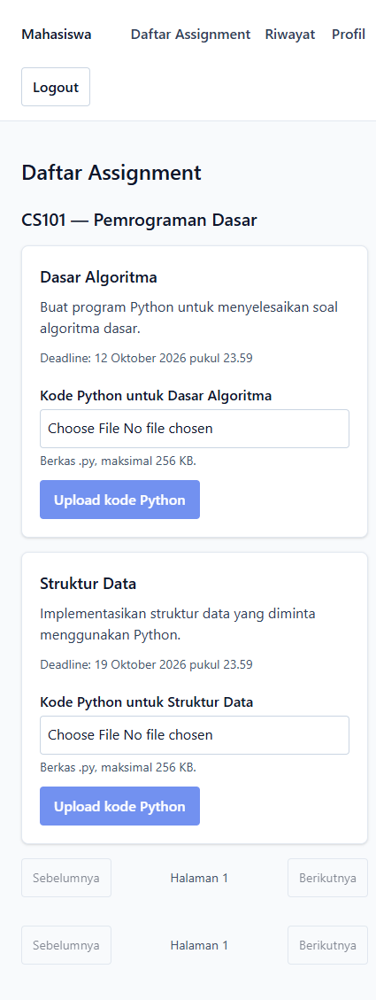
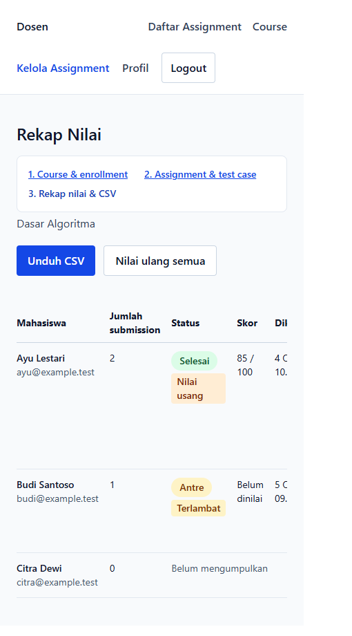

# User flow notes: student and lecturer

These notes describe the visible frontend workflow for a quick-start user
manual. The screenshots below were captured from the local demo frontend at
develop commit `5d518de` with sample accounts and data. They are illustrative
only and are not evidence of a backend UAT.

## Screenshots

Student assignment list:

Lecturer recap and CSV controls:

## Student

1. Sign in with a student account. The navigation shows **Daftar Assignment**,
   **Riwayat**, and **Profil**.
2. **Daftar Assignment** shows each Course as a table: assignment, deadline,
   the late deadline (wider screens), and the latest submission. Open an
   assignment by its title.
3. The assignment page has three views. **Soal** shows the limits (CPU time,
   total time, memory, output), the statement, and every test case the lecturer
   left visible as an example, each with copy buttons. **Kirim kode** takes code
   typed in the editor (Tab indents; Esc then Tab leaves the editor) or a `.py`
   file of at most 256 KB, and follows the grading status live. After the
   deadline it warns that the submission is marked late; after the late
   deadline it offers no form. **Submission saya** lists this assignment's
   submissions with their status and score, opens each report in place, and
   cancels a queued one.
4. If the live connection drops, the status falls back to the submission status
   endpoint; it does not invent a test-case progress count.
5. **Riwayat** still lists every submission across assignments.
6. A hidden test case may show its status and score, but not its input or
   expected output.

## Lecturer

1. Sign in with a lecturer account. Open **Course**, create a Course, then
   enroll students by email.
2. Open **Kelola Assignment** and choose the Course. Create an assignment,
   set all six resource limits, and add or import test cases. The list shows
   whether each test case is visible or hidden.
3. From an assignment, open its recap to review student scores and late/stale
   indicators. Open a submission's code when reviewing the submitted program.
4. Use **Unduh CSV** on the recap page to export the class results. Regrade
   controls are available from the recap workflow when the backend supports
   the operation.

## Scope and cautions

- Navigate with the visible links and buttons rather than entering protected
  routes manually.
- The screenshots use demo data. Do not treat them as proof that the isolated
  database, the campus Nginx deployment, grading, or spreadsheet compatibility
  has been verified.
- Before conducting the real UAT, use a newly provisioned isolated database
  and verify it with `SELECT current_database()` before starting migrations or
  the backend.
