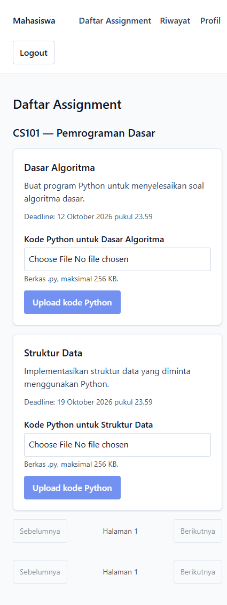
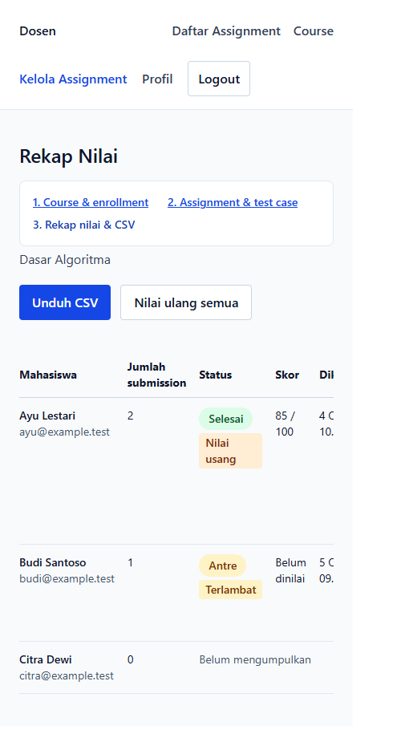

# User flow notes: student and lecturer

These notes describe the visible frontend workflow for a quick-start user
manual. The screenshots below were captured from the local demo frontend at
develop commit `5d518de` with sample accounts and data. They are illustrative
only and are not evidence of a backend UAT.

## Screenshots

Student assignment list:

Lecturer recap and CSV controls:

## Student

1. Sign in with a student account. The navigation shows **Daftar Assignment**,
   **Riwayat**, and **Profil**.
2. In **Daftar Assignment**, find the assignment under its Course. Choose a
   Python `.py` file no larger than 256 KB; **Upload kode Python** becomes
   available after a file is selected.
3. Submit the file and follow the submission status. If the live connection
   drops, the page falls back to the submission status endpoint; it does not
   invent a test-case progress count.
4. Open **Riwayat** to find prior submissions and open a report for its
   test-case verdicts, score, execution time, and memory use.
5. A hidden test case may show its status and score, but not its input or
   expected output.

## Lecturer

1. Sign in with a lecturer account. Open **Course**, create a Course, then
   enroll students by email.
2. Open **Kelola Assignment** and choose the Course. Create an assignment,
   set all six resource limits, and add or import test cases. The list shows
   whether each test case is visible or hidden.
3. From an assignment, open its recap to review student scores and late/stale
   indicators. Open a submission's code when reviewing the submitted program.
4. Use **Unduh CSV** on the recap page to export the class results. Regrade
   controls are available from the recap workflow when the backend supports
   the operation.

## Scope and cautions

- Navigate with the visible links and buttons rather than entering protected
  routes manually.
- The screenshots use demo data. Do not treat them as proof that the isolated
  database, the campus Nginx deployment, grading, or spreadsheet compatibility
  has been verified.
- Before conducting the real UAT, use a newly provisioned isolated database
  and verify it with `SELECT current_database()` before starting migrations or
  the backend.
